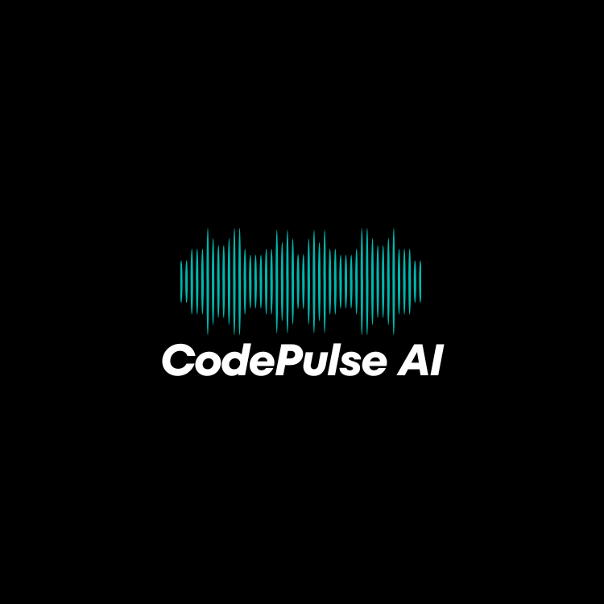

<div align="center">
  <a href="https://github.com/MusthabaSM/CodePulse-AI">
    
  </a>
  <h1>CodePulse AI</h1>
  <p><strong>The Enterprise Repository Intelligence & Technical Debt Engine</strong></p>
  
  [](https://opensource.org/licenses/MIT)
  [](https://www.typescriptlang.org/)
  [](https://nextjs.org/)
  [](https://nestjs.com/)
  [](https://python.org)

</div>

---

## 🚀 Overview

CodePulse AI transforms raw source code into actionable business intelligence. Built for CTOs and Engineering Managers, it utilizes static analysis and Machine Learning to quantify technical debt, predict bug-prone files, and calculate the exact financial ROI of refactoring.

Instead of generic linting warnings, CodePulse AI tells you:
> *"Refactoring the Authentication module will take 40 hours, but save $31,250 annually in debugging time, while reducing your overall release risk by 18%."*

## ✨ Flagship Features

- 🧠 **ML Bug Risk Prediction**: Powered by XGBoost, trained on historical Git churn and complexity metrics to flag files before they fail in production.
- 💰 **Business Financialization Engine**: Translates cyclomatic complexity and code entropy into exact dollar amounts and productivity loss percentages.
- 🤖 **AI Engineering Consultant**: An integrated RAG LLM assistant (Gemini/Claude) that answers strategic architectural questions about your codebase.
- 📊 **Repository Benchmarking**: Split-screen comparative analysis allowing you to measure health improvements Release-over-Release.
- 📄 **Executive Reporting**: High-fidelity, McKinsey-style PDF exports designed for stakeholder presentations.

## 🏗 Architecture

CodePulse AI is a modern microservices architecture:

1. **Frontend**: Next.js 14 App Router, React, CSS Modules (Dashboard, Analytics UI).
2. **Backend API**: NestJS, Prisma ORM, PostgreSQL (Orchestration, Business Logic, AI Routing).
3. **Analysis Engine**: Python, FastAPI, Scikit-Learn, Radon, Lizard (Deep AST parsing and ML inference).

## ⚡ Quickstart

We provide a seamless Dockerized environment for immediate local deployment.

```bash
# 1. Clone the repository
git clone https://github.com/acme/codepulse-ai.git
cd codepulse-ai

# 2. Configure environment
cp backend/.env.example backend/.env
cp frontend/.env.example frontend/.env

# 3. Spin up the cluster
docker-compose up -d

# 4. Access the platforms
# Frontend UI: http://localhost:3000
# Backend Swagger Docs: http://localhost:4000/api/docs
# Python Analysis API: http://localhost:8000/docs
```

## 📚 API Documentation

The NestJS backend implements the OpenAPI specification. Once running, visit `/api/docs` to interact with the interactive Swagger UI.

## 🔐 Authentication & Enterprise Integration

CodePulse AI utilizes **Clerk** for robust B2B authentication, Organization mapping, and Role-Based Access Control (RBAC). A seamless `AuthService` abstraction allows drop-in replacements for Auth0 or custom JWT solutions for on-premise deployments.

## 🤝 Contributing
We welcome contributions! Please read our `CONTRIBUTING.md` for guidelines on how to open PRs.

---
*Built with ❤️ by the CodePulse AI Engineering Team.*
